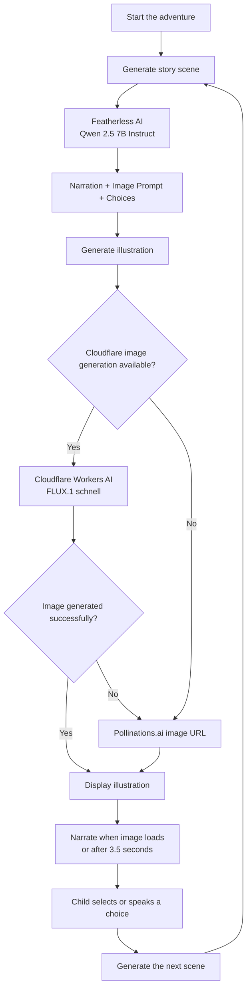

# Frond & Forest 🌿

> **A storybook where children don't just follow the story. They help shape what happens next.**


<!-- todo maybe: screenshot or gif -->

## The Idea

Stories can become more engaging when children get to participate rather than simply follow along.

I built **Frond & Forest** to explore a different approach to storytime: what if a child could choose what happens next, see that choice become an illustration, and hear the story continue around it?

Instead of following a completely predetermined narrative, children can choose from suggested actions or speak a choice into the microphone. An AI model generates the next scene, an image model illustrates it, and the browser reads the narration aloud.

The project explores how interactive storytelling might make reading experiences more engaging, particularly for young readers who find conventional reading formats difficult to stay focused on. It is an early prototype, not a proven literacy intervention.

## What It Does

Frond & Forest combines AI-generated storytelling, illustrations, and browser-based voice interaction in one experience.

### 📖 Stories that respond to choices

Each scene includes narration and suggested actions. Selecting an action influences the next scene, giving the story a branching structure.

### 🎨 AI-generated illustrations

Each new scene includes an image prompt generated alongside the narration. The application uses that prompt to generate a corresponding illustration.

### 🎙️ Voice interaction

On supported browsers, children can speak a displayed choice instead of clicking it. The app uses browser speech recognition to match the transcript against the current options.

### 🔊 Spoken narration

The browser's speech-synthesis API reads the generated narration aloud. Users can also replay the current narration manually.

### 🌱 A storybook-inspired interface

The interface uses a forest-themed visual design, with scene illustrations, narration, suggested choices, and simple controls arranged around the storytelling experience.

---

## How It Works

The application connects a language model, image generation, and browser speech APIs to produce each scene.



### Story generation

The `/api/story` route sends the current action and a short excerpt of the previous narration to Featherless AI, using `Qwen/Qwen2.5-7B-Instruct`.

The model is prompted to return structured JSON containing the next narration, an image-generation prompt, and interactive choices.

### Illustration generation

The `/api/image` route attempts to generate an image through Cloudflare Workers AI using `@cf/black-forest-labs/flux-1-schnell` when the necessary credentials are configured.

If the Cloudflare request fails or the provider is unavailable, the route returns a Pollinations.ai image URL instead. The interface also provides a retry option if an image fails to load.

### Voice and scene transitions

Speech recognition and narration use browser APIs rather than separate speech-processing services managed by the application.

The next scene is generated on demand. Image generation follows story generation, and narration normally starts when the image loads. A 3.5-second timeout prevents narration from waiting indefinitely, so the image and narration are not strictly synchronized in every situation.

---

## Engineering Notes

### Handling structured LLM output

The story API expects JSON rather than plain text. It removes optional Markdown code fences before parsing the response.

This handles some common formatting variations, but it does not guarantee valid output. Malformed JSON or missing fields can still cause a request to fail.

### Supporting multiple image providers

The image route accommodates two providers with different response formats.

Cloudflare's base64 image response is converted into a browser-renderable data URL. When the primary provider cannot return a usable response, the application falls back to a URL-based image-generation request through Pollinations.ai.

The fallback improves resilience at the request-routing level, although it cannot guarantee that the alternative provider successfully generates an image.

### Coordinating asynchronous operations

Each scene requires multiple operations to finish in the correct order: story generation, image generation, image rendering, and narration.

The client coordinates image loading with speech synthesis and includes a timeout for slow image loads. This provides a practical transition between scenes without assuming every external request will finish immediately.

### Maintaining story continuity

The next request includes the selected action and up to 300 characters of the previous narration.

This provides limited continuity between scenes, but the application does not retain a complete conversation history or structured world state. More robust story memory is a planned improvement.

---

## Current Limitations

Frond & Forest is a hackathon prototype, and several capabilities remain intentionally limited.

- **Voice input:** Speech recognition depends on browser support and microphone permission. The current implementation uses `webkitSpeechRecognition`, recognizes English, and matches speech against the displayed choice labels.
- **Story memory:** Only a short excerpt of the preceding narration is passed into the next request. Earlier scenes and choices are not maintained as a complete story history.
- **Generated content:** Model responses are not fully schema-validated, and the project does not currently include comprehensive story-content moderation or age-appropriateness checks.
- **Narration timing:** Narration can begin after a timeout even if an illustration has not finished loading.
- **Persistence:** Story state exists in React memory and is lost when the page is reloaded. There is no account system or save/resume functionality.
- **Accessibility:** The interface includes basic labels and keyboard-focus styles, but comprehensive accessibility testing and descriptive alternatives for generated illustrations have not been implemented.

Because the project does not yet include content moderation, parental controls, or abuse protection, it should be treated as a prototype rather than a production-ready service for unsupervised child use.

---

## Roadmap

### Phase 1: Improve the Core Experience

The immediate focus is on making individual storytelling sessions more reliable.

- Validate structured story output and handle malformed responses more gracefully
- Improve story memory across multiple scenes
- Make spoken-choice matching more tolerant of recognition errors
- Improve browser compatibility for voice input
- Add descriptive scene alternatives and improve accessibility
- Add automated tests and measure provider latency and failure rates

### Phase 2: Make Stories More Personal

Once the core experience is more reliable, the interface and storytelling can be expanded.

- **Character voices:** Give different characters distinct narration styles.
- **Ambient audio:** Add optional nature soundscapes that complement each scene.
- **Storybook transitions:** Make scene changes feel more like turning pages in an illustrated book.
- **Exportable stories:** Let families export completed adventures as printable PDF storybooks.
- **Story history:** Allow users to save, revisit, and resume previous adventures.

### Safety and Production Readiness

Before expanding use beyond a prototype, the application also needs stronger content-safety controls, server-side credential management, rate limiting, and better error monitoring.

The longer-term aim is to make interactive storytelling more flexible and engaging without sacrificing reliability or age-appropriate design.

---

## Tech Stack

| Layer | Technology |
|---|---|
| Framework | Next.js 16 |
| UI | React 19 |
| Language | TypeScript |
| Styling | Tailwind CSS 4 |
| Story generation | Featherless AI |
| Language model | Qwen/Qwen2.5-7B-Instruct |
| Primary image generation | Cloudflare Workers AI |
| Image model | FLUX.1 schnell |
| Image fallback | Pollinations.ai |
| Speech recognition | Browser Web Speech API |
| Speech narration | Browser Speech Synthesis API |
| Package manager | npm |

---

## Local Development

### Prerequisites

You need Node.js and npm, plus a Featherless AI API credential for story generation.

Cloudflare Workers AI credentials are optional. Without them, the application uses its Pollinations.ai image-generation path.

### 1. Clone the repository

```bash
git clone https://github.com/your-username/frond-and-forest.git
cd frond-and-forest
npm ci
```

Replace the repository URL with the actual GitHub URL.

### 2. Configure credentials

Create a `.env.local` file in the project root:

```env
FEATHERLESS_API_KEY=your_featherless_api_key_here
CF_ACCOUNT_ID=your_cloudflare_account_id
CF_API_TOKEN=your_cloudflare_api_token
```

`FEATHERLESS_API_KEY` is the intended server-side configuration for the story model. The current audited version still has the Featherless authorization credential embedded directly in `app/api/story/route.ts`, so that route must first be updated to read `process.env.FEATHERLESS_API_KEY`. Do not publish the embedded credential; rotate it if it has been exposed.

`CF_ACCOUNT_ID` and `CF_API_TOKEN` enable the primary Cloudflare image-generation route. They are optional if you use the Pollinations.ai fallback.

Never commit `.env.local` or expose API credentials in client-side code.

### 3. Start the development server

```bash
npm run dev
```

Open [http://localhost:3000](http://localhost:3000) in your browser.

For a production build:

```bash
npm run build
npm start
```

Microphone access and speech recognition depend on browser support and permissions.

---

## Project Status

Frond & Forest currently demonstrates the core interactive storytelling loop: generating a scene, illustrating it, narrating it aloud, and letting the child choose what happens next.

Persistent stories, stronger story memory, comprehensive content moderation, character-specific voices, ambient audio, and PDF export remain future work.
